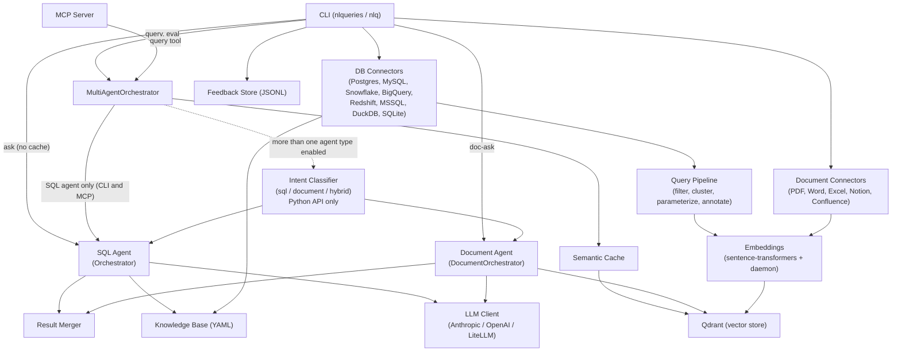

# Architecture

## Request flow



A question from `nlqueries query` or the MCP `query` tool reaches the `MultiAgentOrchestrator` (`nlqueries eval` generates its SQL through it too); `nlqueries ask` uses the single-agent `Orchestrator` directly, with no cache. The `MultiAgentOrchestrator` first checks the semantic cache; on a miss it dispatches to an agent. `query` and the MCP `query` tool enable only the SQL agent, so their questions go straight to it without classification. The intent classifier and the result merger, which can send a question to the document agent or to both in parallel (hybrid), apply only when a caller of the Python API enables more than one agent type. Questions about documents are asked with `doc-ask`, which searches the chunks `doc-ingest` stored.

## Module layout

```
nlqueries/
├── cli/                 CLI commands (click + rich) — connect, query, ask, health, kb-stats, etc.
├── connectors/           DB connector implementations + DatabaseConnector ABC (base.py)
│   ├── postgres.py, sqlite.py
│   ├── sqlalchemy_connector.py                  (generic SQLAlchemy-URL connector; MySQL runs on it)
│   └── snowflake.py, bigquery.py, redshift.py, mssql.py, duckdb.py   (optional extras)
├── document_connectors/  PDF, Word, Excel, Markdown/text, Notion, Confluence + DocumentConnector ABC, chunker
├── processing/           Query filter, clusterer, parameterizer, intent annotator, pipeline
├── knowledge/            YAML knowledge base generator (kb_generator.py), kb-stats report (kb_stats.py),
│                         dbt artifact importer (dbt_importer.py)
├── embeddings/           Sentence-transformer embedder, Qdrant store, embedding daemon (embed_server.py)
├── cache/                Semantic cache (semantic_cache.py) + entry signing (envelope.py)
├── llm/                  LLM client abstraction — Anthropic, generic client, LiteLLM
├── orchestrator/         Orchestrator, intent classifier, multi-agent + document orchestrators,
│                         prompt assembly, SQL generation + sqlglot validation, result merger,
│                         conversation / follow-up handling
├── verbalizer/           Deterministic SQL-to-English paraphrase (no LLM)
├── analysis/             Query analyzer
├── auth/                 OIDC token verification (oidc_token.py), MCP bearer-token verifier
│                         (mcp_verifier.py), principal + audit record (principal.py), authorizer,
│                         per-tool enforcement, per-principal admission limits (admission.py)
├── feedback/             Local JSONL feedback store + models, promotion of rated answers to Qdrant
├── mcp_server/           MCP server entry point
├── sql_policy.py         Which generated statements may run (whole-tree sqlglot checks)
├── sql_constructs.py     The sqlglot classes a query may contain, per dialect
├── sql_policy_report.py  Reports what sql_policy would refuse, without refusing it
├── execution.py          Execution permission carried from the entry point to the connector
├── kb_eval.py            KB eval harness behind `nlqueries eval`
├── state_files.py        File permissions, and private atomic writes, for what NLQueries writes as state
├── telemetry.py          OpenTelemetry integration
└── config.py             Environment-variable configuration
```

## Cache partitioning and authorisation

The semantic cache is partitioned by agent: one Qdrant collection per agent,
named `cache_{agent_id}`. **Every entry in a collection is readable by everyone
who may query that agent.** That is not a gap in the model, it is a restatement
of it -- authorisation is granted at agent level, row filters are a property of
the agent record rather than of the caller, and cached SQL is replayed through
the same filtered connector that produced it, so a replay is subject to the
filters a fresh run would be. Document answers are cached verbatim, and every
user of the agent is entitled to the same documents.

That reasoning holds only as long as nothing narrows what a caller may see
*below* the agent. The invariant to preserve:

> Anything that makes two callers of the same agent entitled to different
> results -- per-user row filters, per-user document ACLs, row-level security
> keyed on caller identity, per-user column masking -- must contribute its
> distinguishing value to `cache_context` on **both** `get()` and `put()`.
> If it cannot, it must not be built.

`cache_context` (seam S2) is stored in the entry payload on write and compared
on read. The comparison is an **equality**, not a subset test: a caller that
passes no context reads only entries written with none. That direction matters
more than it looks. The failure being guarded against is a caller that forgets
to pass its context on one `get()` path, and under a subset test that caller
would have matched entries scoped by every context -- failing open, silently,
in exactly the case the mechanism exists for.

The context is recovered from the payload as whatever keys the cache did not
write itself (`_RESERVED_PAYLOAD_KEYS` in `cache/semantic_cache.py`), so there
is no marker field to keep in sync and entries written before the check existed
are still read correctly. A consequence worth knowing: **adding a new key to a
stored payload without adding it to that set makes it count as caller context,
and every entry carrying it will miss.**

**The context is covered by the signature.** `envelope.py` protects a cache
entry against anyone with write access to Qdrant but no access to the signing
key. Until the context was part of the signed message, that protection stopped
at the partition: reaching another context did not require forging a tag, only
moving a valid one, by editing the context keys the HMAC did not cover. The
context is now appended to the signed message -- but only when it is non-empty,
so an entry written without one produces byte-identical output to before and
keeps verifying. Only context-carrying entries pay a one-off miss on upgrade,
rather than the whole cache going cold. Conditional inclusion is still sound
both ways: stripping a context makes the verifier build the short message
against a tag computed over the long one, and adding a context does the reverse.

**The point ID carries the context too.** `put()` used to derive point IDs from
the question alone (`_point_id_for_question(normalized)`, and `tmpl:{masked}` for
the template point), so two callers in different contexts asking the same
question upserted over one another. That is not a future problem: `cache_context`
is already in use for follow-up turns, so a scoped follow-up write and a
context-free write of the same normalised question collided. The partition still
held -- neither read the other's entry -- but each clobbered the other and both
then missed indefinitely, which is a collapsed hit rate rather than a leak and
correspondingly harder to attribute. The context is now part of the id, appended
only when non-empty so entries written without one keep the id they had.

**The answer point's id also carries the normalisation version.**
`_answer_point_id` hashes `normalization-v{N}` ahead of the normalised question,
so when the normalisation changes, an id written under the old one cannot be the
id a different question now normalises to. Each existing entry is then a
one-time Tier 0 miss. A test pins one id to a literal value: when it fails, the
normalisation has changed and `_NORMALIZATION_VERSION` must be bumped with it.

**The collection is swept on write, because the point ID no longer bounds it.**
Nothing else deletes: the TTL is applied on *read*, in `_payload_to_entry`, and
`invalidate()` drops the whole collection. That was survivable while a repeated
question upserted over its own id, since the point count then tracked an agent's
distinct question vocabulary. Once the id carried the cache context it stopped
being true -- enterprise derives `context_fingerprint` from the conversation
summary, the last SQL and a window of turns, so it changes on virtually every
follow-up turn, and each turn wrote points at an id that never recurs, was never
overwritten and was never removed.

`_prune_expired` deletes points past the TTL, at most once per collection per
`NLQ_CACHE_PRUNE_INTERVAL_SECONDS` (default one hour; `0` disables it), after the
upsert so a failed sweep cannot cost the caller the write that prompted it. The
cutoff is the same `ttl_hours` the read path applies, so it can only remove what
a read would already have discarded -- it cannot delete a servable entry.

Two things this also fixes, which were true before the id change and simply less
visible: expired points were still *ranked* by the vector search, since the TTL
is checked afterwards, so they consumed the candidate slots described below; and
scoped entries written before the id change are orphaned under ids nothing will
look up, so only an age-based sweep can ever reclaim them.

That the filter behaves correctly is established against a real Qdrant in
`tests/integration/test_cache_prune_integration.py`, not inferred. `created_at`
is an ISO string; a `DatetimeRange` that needed a datetime index it did not have
would either match nothing or -- far worse -- match everything, and the
difference between those is a cache that grows and a cache that is gone. It was
measured on v1.9.3 and v1.18.2 and holds indexed, keyword-indexed and unindexed
alike: correctness never depended on the index. `docker-compose.yml` now pins
v1.18.2 -- v1.9.3 predates the `query_points` API
every search here goes through, so it was never a version this project could run
against, only one it used to ship.

Speed does, which is why the sweep is issued with `wait=False` and `created_at`
is now indexed **as a datetime**. `ensure_collection`'s `payload_indexes`
creates *keyword* indexes, which do nothing for a range query over a timestamp,
so it grew a `datetime_indexes` argument rather than accepting an index that
would have looked like a fix. Collections created before this keep their
unindexed field and are swept by a scan; because the request does not wait, that
scan is Qdrant's problem rather than the caller's.

**The context is matched inside the query, so the candidate window no longer
carries the partition.** Qdrant's filter cannot require the *absence* of keys it
was not told about, so matching a context key by key is a subset test: entries
belonging to other callers came back and had to be discarded after the search,
consuming the candidate slots a lookup scans. `put()` therefore writes a digest
of the context under a reserved key, and `get()` asks for that one value.

A context-free read is the case needing care, because entries written before the
key existed do not carry it. That side of the filter is a disjunction -- either
no digest, or the digest of an empty context -- so those entries stay readable
and no cache has to be rebuilt. Measured against a real Qdrant, since getting it
wrong would make every unscoped entry in every existing deployment unreadable at
once.

The disjunction is on that branch only. A **scoped** read takes the exact-match
path, so a pre-digest entry carrying a context is no longer reachable through
Tier 1 or Tier 2 -- and, since Tier 0's id now also carries the normalisation
version, not through Tier 0's id retrieval either. That costs nothing in
practice: the signature now covers the context and the point id now includes it,
so an entry written with a context by any released version already fails
verification. The narrower claim is the true one, and it is worth stating
narrowly rather than letting "no entry becomes unreadable" stand.

The digest is derived from the context rather than signed with it. It can
therefore misdirect a lookup but cannot get a foreign entry served:
`_payload_matches` still compares the real, signed context before anything is
returned. The filter is an optimisation over that check, not a replacement for
it.

`NLQ_CACHE_COSINE_CANDIDATES` remains, and is still doing work -- a candidate can
fail verification, expiry or entity binding -- but it no longer has to absorb
other callers' entries. Twenty scoped entries ranked above an unscoped one used
to starve it against a window of five; a hundred now do not.

**Why the cosine tiers still fetch more than one candidate.** Not to absorb
other callers' entries -- the digest condition above keeps those out of the
result entirely. A candidate that belongs to the right context can still be
unusable: its signature may not verify, it may be past the TTL, or its entities
may not bind into the stored template. The window gives the lookup somewhere to
go when the nearest match fails one of those, rather than reporting a miss with
a usable entry one rank below.

Both tiers take the first candidate clearing the threshold *and* every check,
and stop scanning at the first below-threshold point, so widening the window
cannot lower the similarity bar.

The invariant is guarded by `tests/test_cache_partitioning.py`, which asserts
across all three tiers that an entry written under one context is a miss for a
different context and for no context, and -- as the control that gives those
their meaning -- a hit for its own.

See [cli-reference.md](cli-reference.md) for what each CLI command does, [connectors.md](connectors.md) for connector-specific behavior, and [configuration.md](configuration.md) for the environment variables that wire these modules together.
